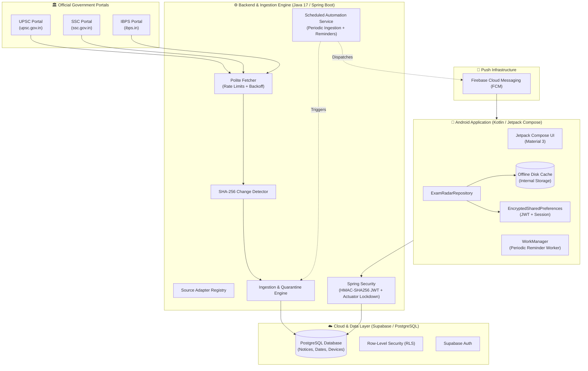

# ExamRadar India 🇮🇳
> **Official Examination & Recruitment Portal Tracker for Indian Aspirants**  
> *Zero Ads • Zero Test Series Upselling • 100% Verified Official Sources*

[](https://github.com/examradar/examradar/actions/workflows/ci.yml)
[](LICENSE)
[-brightgreen.svg)](apps/android)
[](services/backend)
[](services/backend)

---

## 📌 Executive Summary

Every year, over 30 million Indian graduates and final-year students prepare for competitive public sector and banking examinations (UPSC, SSC, IBPS, SBI, RBI, Regulatory bodies). Today, candidates face two major pain points:
1. **Missed Deadlines:** Application windows, corrigenda, and admit cards are buried across disparate, archaic government websites.
2. **Commercial Bloat & Misinformation:** Existing educational apps bombard candidates with aggressive paid mock test series, video courses, banner ads, and clickbait notification spam.

**ExamRadar India** is an open, candidate-centric technological platform built to solve this problem. It continuously monitors official government recruitment portals, verifies notices using cryptographic SHA-256 hashing, and delivers critical updates directly to candidate devices with date-sensitive deadline reminders.

---

## 🏛️ Official Non-Affiliation Disclaimer

> **Important Disclosure:**  
> **ExamRadar India is an independent technological platform and is NOT affiliated with, associated with, authorized by, endorsed by, or in any way officially connected with the Union Public Service Commission (UPSC), Staff Selection Commission (SSC), Institute of Banking Personnel Selection (IBPS), Reserve Bank of India (RBI), or any other Government entity or examination authority.**  
> 
> All announcements, notifications, admit card alerts, and recruitment notices presented in this application are sourced directly from publicly accessible official government gazettes and portals (e.g., `https://upsc.gov.in`, `https://ssc.gov.in`, `https://ibps.in`). Every card in the application links directly to the official original public PDF or announcement URL.

---

## ✨ Key Features

- **🛡️ 100% Verified Official Feeds:** Automated scrapers inspect official government portals directly. Every notice includes a direct link to the original official PDF/portal URL.
- **⚡ Cryptographic Change Detection:** SHA-256 content hashing detects new releases and corrigenda instantly, preventing redundant alerts while capturing official revisions.
- **📱 Modern Jetpack Compose Android Client:**
  - Modern Material 3 UI with dark mode support.
  - **Offline Disk Caching:** Announcements and exams are cached to internal storage; candidates can browse announcements offline during low-connectivity commutes.
  - **Pull-to-Refresh:** Instant feed re-validation via Material 3 gesture.
  - **Granular Target Filtering:** Filter notices by exam categories (UPSC, SSC, Banking, Regulatory).
  - **Interactive Application Checklist:** Track document prep, photo/signature guidelines, fee payments, and confirmation receipts with local and cloud backup.
  - **Android 13+ Notification Permission Launcher:** Compliant runtime notification permission handling.
  - **Deep Linking:** Launch directly into specific examination notices via `examradar://notices/{id}` or `https://app.examradar.in/notices/{id}`.
- **🔔 Firebase Cloud Messaging (FCM):** Push alerts for new notifications, admit cards, results, and critical application deadlines (7-day, 3-day, and 1-day reminders).
- **🔒 Supabase Auth & Multi-Device Sync:** Silent token refresh with EncryptedSharedPreferences; preferences and checklists automatically sync across devices.
- **🚀 Ultra-Fast Optimized API:** N+1 query elimination and batch relation fetching with response times under 2 seconds across 100+ notices.

---

## 🏗️ System Architecture



---

## 🗂️ Project Repository Structure

```text
ExamRadar/
├── .github/
│   └── workflows/
│       ├── ci.yml                     # Continuous integration for backend & Android
│       └── scheduled-collector.yml    # Standalone GitHub Actions scheduled crawler
├── apps/
│   └── android/                       # Native Android Application
│       ├── app/
│       │   ├── src/main/java/com/examradar/app/
│       │   │   ├── data/
│       │   │   │   ├── cache/         # Offline atomic disk cache
│       │   │   │   ├── model/         # Immutable domain data models
│       │   │   │   ├── preferences/   # EncryptedSharedPreferences & DataStore
│       │   │   │   ├── remote/        # OkHttp, Retrofit, Supabase Auth
│       │   │   │   └── repository/    # ExamRadarRepository implementation
│       │   │   ├── notification/      # FCM Service, NotificationManager, WorkManager
│       │   │   └── ui/                # Jetpack Compose Screens (Home, Discover, Calendar, Account)
│       │   └── proguard-rules.pro     # Production R8/Proguard rules
│       └── build.gradle.kts
├── services/
│   └── backend/                       # Spring Boot 3.3 Backend & Ingestion Engine
│       ├── src/main/java/com/examradar/backend/
│       │   ├── collector/             # Polite scrapers (UPSC, SSC, IBPS) & IngestionEngine
│       │   ├── controller/            # REST API (Notices, Exams, Calendar, Profile, Admin)
│       │   ├── domain/                # JPA Entities (Notice, NoticeDate, NoticeVersion, etc.)
│       │   ├── notification/          # Firebase Admin SDK & Push Dispatcher
│       │   ├── repository/            # Spring Data JPA repositories with batch queries
│       │   ├── scheduler/             # ScheduledAutomationService (@Scheduled cron)
│       │   └── security/              # JWT filter, Admin API key, Actuator lockdown
│       ├── Dockerfile                 # Multi-stage production container
│       └── pom.xml
├── database/
│   ├── migrations/                    # Flyway SQL schema migrations
│   ├── seed/                          # Reference examination metadata
│   └── supabase_master_setup.sql      # Supabase RLS policies and initial schema
├── docs/                              # Technical architecture, deployment, and security docs
├── docker-compose.yml                 # Local & cloud container orchestration
├── .env.example                       # Environment variable reference
├── CONTRIBUTING.md                    # Open-source contribution guidelines
├── LICENSE                            # Apache 2.0 license
├── PRIVACY_POLICY.md                  # Google Play-compliant privacy policy
└── SECURITY.md                        # Security policy and vulnerability disclosure
```

---

## 🚀 Getting Started

### Prerequisites

- **Java Development Kit (JDK):** Version 17+
- **Android Studio:** Ladybug (2024.2.1+) or newer
- **Android SDK:** API Level 35 (compileSdk), Minimum Android 8.0 (API 26)
- **Apache Maven:** 3.8+ (or use `./mvnw`)
- **Docker & Docker Compose:** Optional for containerized deployment

---

### 1. Backend Setup

1. **Clone the repository:**
   ```bash
   git clone https://github.com/examradar/examradar.git
   cd examradar/services/backend
   ```

2. **Configure Environment Variables:**
   Copy `.env.example` in the root directory to `.env` or export variables:
   ```bash
   export DB_PASSWORD=your_supabase_postgres_password
   export SUPABASE_JWT_SECRET=your_supabase_jwt_secret
   export ADMIN_API_KEY=your_secure_admin_api_key_32_chars
   ```

3. **Run Unit & Integration Tests:**
   ```bash
   mvn clean test
   ```
   *(All 48 test suites execute against an embedded H2 in-memory test database with 0 external dependencies).*

4. **Launch Local Server:**
   ```bash
   mvn spring-boot:run
   ```
   - API endpoints: `http://localhost:8085/api/v1/notices`
   - Healthcheck: `http://localhost:8085/actuator/health`
   - Swagger / OpenAPI: `http://localhost:8085/swagger-ui.html`

---

### 2. Android App Setup

1. **Open `apps/android` in Android Studio.**
2. **Add Firebase configuration:**
   - Download your project's `google-services.json` from the [Firebase Console](https://console.firebase.google.com).
   - Place it inside `apps/android/app/google-services.json`.
3. **Compile & Run Unit Tests:**
   ```bash
   cd apps/android
   ./gradlew testDebugUnitTest
   ```
4. **Deploy to Emulator / Physical Device:**
   ```bash
   ./gradlew installDebug
   ```
   *The debug build automatically bridges to the local backend at `http://10.0.2.2:8085`.*

---

### 3. Containerized Deployment (Docker)

To run the production backend service with Docker:

```bash
docker compose up -d --build
```

---

## 🏛️ Supported Examination Authorities

| Organization | Full Name | Official Portal | Ingestion Method |
|:---|:---|:---|:---|
| **UPSC** | Union Public Service Commission | `https://upsc.gov.in` | HTML Scraping (`/whats-new`) + PDF extraction |
| **SSC** | Staff Selection Commission | `https://ssc.gov.in` | REST / Notice Board Scraper |
| **IBPS** | Institute of Banking Personnel Selection | `https://ibps.in` | RSS / Notice Parser |
| **SBI** | State Bank of India Recruitment | `https://sbi.co.in/careers` | Official Careers Board Adapter |
| **RBI** | Reserve Bank of India Opportunities | `https://opportunities.rbi.org.in` | Opportunities RSS / Gazette |

---

## 🛡️ Polite Scraping & Rate Limiting Policy

ExamRadar India strictly respects government infrastructure:
- **Rate Limiting:** Minimum 2000ms delay between consecutive HTTP requests to the same domain.
- **Identification:** Every request identifies itself via a transparent User-Agent (`ExamRadarBot/1.0 (+https://examradar.in/bot; bot@examradar.in)`).
- **Conditional GETs & Hashing:** Content is hashed with SHA-256; if page content has not changed, further parsing is skipped immediately to minimize server load.
- **Off-Peak Execution:** Batch crawls run at low frequencies during off-peak hours.

---

## 🤝 Contributing

We welcome community contributions, particularly for adding new state examination adapters (e.g., UPPSC, BPSC, MPSC, WBPSC) and railway boards (RRB). Please review [CONTRIBUTING.md](CONTRIBUTING.md) for guidelines on code standards, polite crawling rules, and PR requirements.

---

## 📄 License & Privacy

- **Software License:** [Apache License 2.0](LICENSE)
- **Privacy Policy:** [PRIVACY_POLICY.md](PRIVACY_POLICY.md)
- **Security Policy:** [SECURITY.md](SECURITY.md)

---

<p align="center">
  Built with dedication for Indian civil services and banking candidates.
</p>
