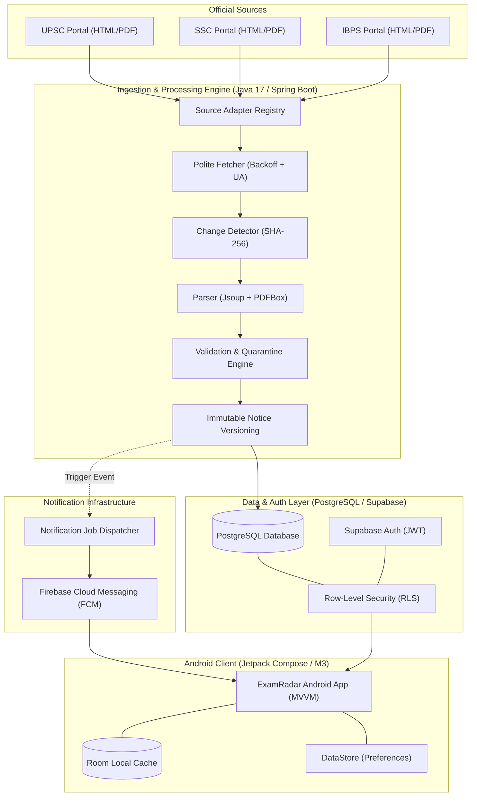

# ExamRadar India — Architecture Specification

## 1. System Overview & Core Promise

ExamRadar India is an independent examination and recruitment tracking platform designed for Indian graduates and final-year students. 

**Core Promise:** *“Never miss a relevant government exam notification or important application deadline.”*

The platform consolidates official recruitment announcements from selected Indian government examination and recruitment organisations (UPSC, SSC, IBPS, Banking, Regulatory, and PSUs) and presents them in a personalised mobile dashboard with guaranteed data integrity, immutable revision tracking, and date-sensitive deadline reminders.

> **Important Disclaimer:** ExamRadar India is an independent informational service and does **not** claim official government affiliation, endorsement, or representation. All candidate notices link directly to the original official gazette/portal URLs.

---

## 2. High-Level Architecture & Operating Modes



### Dual-Mode Architecture

| Feature | Mode A (Zero-Recurring Cost MVP) | Mode B (Conventional Production Backend) |
| :--- | :--- | :--- |
| **Target Runtime** | Supabase Free tier + Scheduled GitHub Action / Local Runner | Spring Boot REST Service (port 8080) on Cloud / VPS |
| **Android Data Access** | Supabase Client (PostgREST) protected by RLS | Spring Boot REST API (`/api/v1/*`) |
| **Authentication** | Supabase Auth (Email / Password / Anonymous) | Supabase Auth JWT verified server-side by Spring Security |
| **Source Collection** | Headless Java Collector run via Scheduled CI / CLI | Spring Boot `@Scheduled` worker or internal task executor |
| **Push Dispatch** | Notification Worker CLI triggered after verified run | Internal Notification Dispatcher daemon |
| **Monthly Cost** | **₹0.00 / $0.00** | Standard compute & db hosting fees |

---

## 3. Android Application Architecture

The Android application is built in Kotlin targeting Android 14/15 (API 34/35) using modern Android Jetpack best practices:

- **Presentation Layer:** 100% Jetpack Compose with Material 3 design system. Strict adherence to state hoisting, unidirectional data flow (UDF), and edge-to-edge layout.
- **Architecture Pattern:** MVVM (Model-View-ViewModel) with Kotlin Coroutines and reactive `StateFlow`.
- **Navigation:** Jetpack Navigation Compose with type-safe screen routes and deep-linking support for push notifications.
- **Local Persistence & Caching:**
  - **Room Database:** Caches approved examinations, notices, and offline calendar entries to ensure zero latency and offline reading.
  - **Jetpack DataStore:** Persists user onboarding state, selected exam categories, notification preference flags, and deadline reminder intervals.
- **Network Layer:** Modular data repository providing unified access. Can switch transparently between Supabase Direct Mode (Mode A) and Spring Boot REST API Mode (Mode B).
- **Background Execution:** `WorkManager` for non-critical periodic background sync and cached notice freshness verification.
- **Push Notifications:** Firebase Cloud Messaging (FCM) receiver handling foreground, background, and killed states with notification channel separation.

---

## 4. Backend & Ingestion Engine (Java 17 / Spring Boot)

The backend is built as a clean **Modular Monolith** in Java 17 LTS:

```
services/backend/src/main/java/com/examradar/backend/
├── admin/               # Admin endpoints & management services
├── collector/           # Ingestion pipeline & source adapters
│   ├── adapter/         # Organization-specific parsers (UPSC, SSC, IBPS)
│   ├── detector/        # SHA-256 fingerprinting & change detection
│   ├── parser/          # Jsoup HTML & PDFBox text extraction
│   └── quarantine/      # Quarantine rules & date consistency checks
├── config/              # Security, OpenAPI, Database & Async configs
├── controller/          # Versioned REST controllers (/api/v1/...)
├── domain/              # JPA Domain Entities & Enums
├── dto/                 # Request/Response DTOs with Bean Validation
├── notification/        # FCM sender, job generation, retry & idempotency
├── repository/          # Spring Data JPA repositories
├── security/            # Supabase JWT validation & role enforcement
└── service/             # Business logic layer
```

---

## 5. Official Source Ingestion & Change Detection

1. **Polite Polling:** Custom HTTP client with explicit User-Agent (`ExamRadarBot/1.0`), respectful request spacing (minimum 2s delay), exponential backoff, and HTTP 304 Not Modified validation.
2. **Content Hashing:** Computes SHA-256 hash of downloaded notices. If hash equals `last_successful_content_hash`, parsing is skipped to conserve compute and avoid database churn.
3. **Immutable Notice Versions:** If content changes, a new `notice_versions` record is created. Previous versions remain unaltered for auditability and diffing.
4. **Validation & Quarantine:**
   - Detects opening and closing dates.
   - Enforces temporal consistency: `deadline >= opening_date`.
   - Ambiguous dates, major deadline shifts (>14 days), or cancellations automatically trigger `VALIDATION_REQUIRED` quarantine.
   - Only notices with `PUBLISHED` status are broadcast via FCM or displayed in production feeds.

---

## 6. Idempotent Notification Infrastructure

1. When a notice transitions to `PUBLISHED` or a revised verified deadline is confirmed, the system calculates candidate recipients based on target categories and followed exams.
2. An **Idempotency Key** is derived: `sha256(user_id + notice_id + event_type + version_number)`.
3. Database unique constraint on `notification_jobs(idempotency_key)` guarantees that repeat cron triggers or network retries never send duplicate push alerts.
4. Deadline reminders are scheduled at verified intervals (7 days, 3 days, 1 day prior to deadline).
5. If a deadline is revised in an official notice update, pending obsolete reminders are revoked and rescheduled to match the verified revision.
